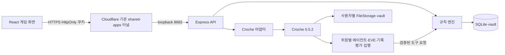
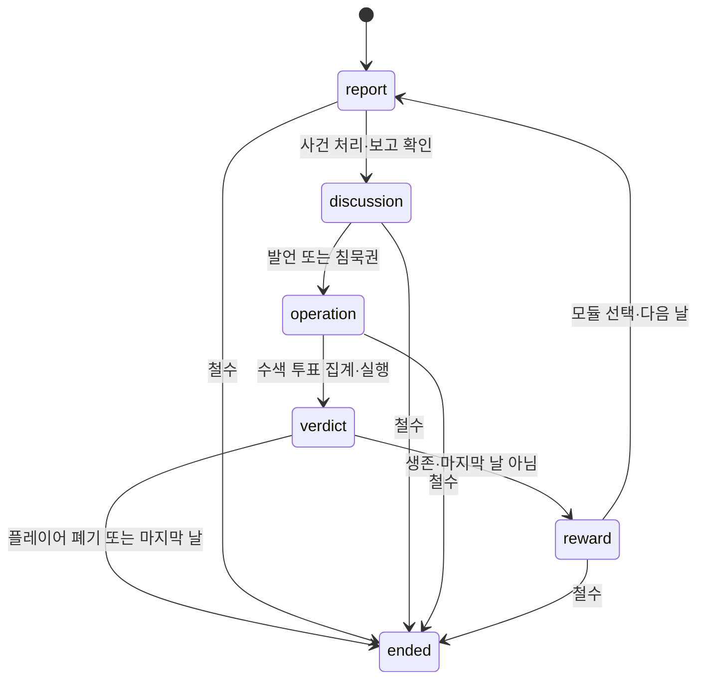

# The Last Vote 상세 기술설명서

최종 갱신 2026-10-16. 이 문서는 실제 구현과 검증 결과를 설명한다. 원래 기획의 장기 수익화 계획을 현재 제공 기능으로 표시하지 않는다.

## 제품과 실행 구조

일반 계정은 7일 잠입을 한다. 서버에 `demo` 역할로 등록된 시연 계정은 3일만 진행하며 하나의 고정 구성(demo-0)을 사용한다. 일반 가입 API는 역할이나 일수를 받지 않는다. 로그인 응답의 역할과 서버 계정 테이블이 판 길이를 결정한다.

브라우저는 UI와 입력을 담당한다. Node 서버는 계정 확인, 게임 상태, 규칙, AI 호출을 맡는다. Croche SDK는 서버 프로세스에서만 실행한다. 브라우저 번들에 계정 키·서버 키·디버그 키가 들어가지 않는다.

프런트엔드는 React 19, Vite 8, TypeScript를 사용한다. 서버는 Node.js 24의 HTTP 런타임과 `node:sqlite`, Express 5, Zod를 쓴다. 암호 검증과 세션 난수는 Node 표준 `crypto`로 처리한다. 운영 DB는 SQLite WAL 모드이며 외부 DB 서버는 필요 없다.

## 코드 경계

| 파일 | 책임 | 외부 의존 |
|---|---|---|
| `engine.mjs` | 모든 단계 전이, 수색·판결·모듈 계산 | Node crypto, 정적 콘텐츠, 서사 상태 |
| `story.mjs` | 기존 인원에 속한 인물 배치, 상태별 무전, 결말, 공개 DTO | Node crypto |
| `content.mjs` | 위원 7종, 구역 4곳, 사건 6종, 모듈 12종, 가면 4종 | 없음 |
| `ai.mjs` | 모델 지시, 문맥, 응답 파싱, 도구, 사용량 | Croche SDK |
| `store.mjs` | 계정, 세션, 판, 사용량, 순위, 요청 제한 | Node SQLite·crypto |
| `index.mjs` | 인증, JSON 검증, 동시 작업 제한, 정적 파일 | Express·Helmet·Zod |
| `main.tsx` | 접속, 작전실, 지도, 대화, 판결, 보상, 기록 | React·Phosphor |
| `SurvivorRadio.tsx` | 최근 생존자 무전, 인물별 연락 기록, 마지막 소식 | React·Phosphor |

규칙 엔진은 네트워크와 분리돼 있다. AI가 없거나 잘못된 JSON을 보내도 인원 보존, 단계 순서와 과반 판결을 같은 코드로 검사한다. SDK 도구가 실행하는 수색·판결도 이 엔진 함수를 사용한다.

## 계정·세션·저장

| 테이블 | 주요 내용 | 분리 기준 |
|---|---|---|
| `users` | 아이디, scrypt 검증값, 역할, 해금·최고 기록 | 사용자 UUID |
| `sessions` | 세션 토큰 SHA-256, 사용자, 진행 소유자, 만료 | 로그인 세션 |
| `runs` | 판 UUID, 소유자, 전체 상태 JSON, 수정 시각 | 진행 소유자 |
| `usage` | Croche operationId, 판, 비용, 보고 상태, 토큰 | 고유 operationId |
| `scores` | 판별 구출 인원, 시작 날짜, 일일 도전·순위 인정 여부 | 판 UUID |
| `limits` | 요청 횟수와 만료 시각 | 해시 처리한 요청자·사용자 |

비밀번호는 매번 다른 16바이트 salt와 scrypt 64바이트 결과로 저장한다. 원문을 저장하지 않는다. 비교에는 `timingSafeEqual`을 사용하고, 존재하지 않는 아이디도 scrypt 계산을 수행한다. 세션은 32바이트 난수이며 DB에는 해시만 남긴다. 쿠키는 HttpOnly·SameSite=Strict이고 HTTPS에서는 Secure다. 만료는 7일이다.

일반 계정은 사용자 UUID가 진행 소유자다. 다시 로그인해도 이어서 한다. 시연 계정은 로그인할 때마다 별도 진행 소유자 UUID를 만든다. 같은 시연 아이디를 여러 심사위원이 사용해도 각 로그인 세션의 판과 Croche 기억이 분리된다. 시연 계정의 기록은 일반 해금과 순위에 합산하지 않는다.

DB, SDK 기억, 환경 파일과 시연 비밀번호 원본은 `vault/imnotahuman2/`에 있다. 프로젝트의 `data`와 `.env`는 그 원본을 가리키는 심링크다. 비밀 파일은 Git과 공개 정적 파일 경로에서 제외한다.

## 상태 전이

하루 발언은 2회다. EVE 초안은 하루 최대 4회다. 첫 발언 이후에는 바로 작전으로 넘어갈 수 있다. 침묵권이 있으면 발언을 생략한다. 모든 변경 요청은 현재 상태의 `version`을 보낸다. 이미 반영된 선택이나 다른 탭의 오래된 요청은 409로 거절하고 화면이 최신 상태를 다시 읽는다.

동일 진행 소유자의 작업은 동시에 하나만 처리한다. 전체 서버의 진행 작업은 최대 8개다. 이는 단일 Node 프로세스를 전제로 한 메모리 잠금이다. 프로세스를 여러 개로 늘리려면 DB 잠금 또는 외부 분산 잠금으로 바꿔야 한다.

## 세계 구성과 비공개 정보

일반판은 난수 시드로 위원·인원·신호·사건·모듈을 구성한다. SHA-256에서 만든 정수로 난수 생성기를 시작하므로 같은 시드는 같은 구성을 재현한다. LLM의 발언은 결정적이지 않다. 시연판은 demo-0 하나로 고정하며 2일차 사건은 예산 삭감이다. 같은 초기 구성에서도 AI의 해석·표와 플레이어 선택은 달라진다.

구역은 폐역·배수망·옛 서버실·발전소 네 곳이다. 시작 시 한 구역의 사람을 다른 구역으로 옮겨 빈 수색 후보를 만든다. 총인원은 보존한다. 따라서 네 수색 구역이 항상 네 개의 독립된 유인 거점인 것은 아니다. 매일 센서값을 갱신하고 불씨 무전 한 곳의 실제 인원을 공개한다. 센서 불일치 사건에서는 열 감지와 음향값을 반대로 배치해 판단 근거가 충돌하게 한다.

일반 응답에서 다른 구역의 인원은 `null`이다. 위원 AI에는 센서·비용·공식 기록과 서버가 계산한 최대·최소·음향 편차를 전달하고 생존자 배치와 불씨 무전을 주지 않는다. EVE에는 현재 무전으로 확인한 정보만 전달한다. 무전 증폭을 쓰면 전체 구역의 실제 인원이 공개된다. 시선 추적이 없으면 전체 대상의 의심 평균을 클라이언트에 보내지 않는다.

## 의심과 기록

판마다 달라지는 AI의 평가와 수색 선호는 의도한 난이도다. 서버는 허용된 대상·기록·범위를 검증하고 AI가 반환한 판단을 적용한다. 생존자 서사를 추가하면서 위원 지시문, 모델 설정, 의심 평가와 수색·폐기 기준을 변경하지 않았다. 판정의 예측 가능성을 높이려고 고정 정답표를 추가하지 않는다.

위원마다 다른 개체를 향한 0~100 의심값을 가진다. 시작 시 플레이어는 24, 다른 위원은 18이다. 자기 자신을 향한 의심은 없다. 화면에는 각 위원이 플레이어를 얼마나 의심하는지, 마지막 변화의 사유와 기록 번호를 표시한다.

| 입력 | 서버 반영 |
|---|---|
| AI의 발언·변론 평가 | 방향 up/down/hold와 단계 small/medium/large만 수용 |
| 발언 변화량 | 1 / 2 / 4, 감소일 때 부호 반전 |
| 예산 교란 | 발언 평가 폭 최대 2, 결과 책임 70% |
| 잡음 주입 | 플레이어를 향한 발언 의심 증가를 절반으로 올림 처리 |
| 빈 수색 | 발의자 +14, 지지자 +5 |
| 수색 성과 | 발의자 -10, 지지자 -5 |

AI 평가에는 실제 관찰자·대상·기록 ID가 있어야 한다. 최신 발언 평가에는 그 발언 기록을 인용해야 한다. 없는 기록, 허용하지 않은 방향·단계, 임의의 숫자는 무효다. 같은 날·위원·대상·근거·평가 종류는 한 번만 반영한다.

발언은 NFKC 정규화 후 공백·구두점을 제거해 비교한다. 동일 문자열과 문자 3-gram 포함 유사도 0.86 초과의 반복을 거절한다. 이 처리는 의미가 같은 모든 바꿔 쓰기를 완벽하게 찾지는 못한다. 별도로 기록별 평가 중복도 막아 같은 근거로 감소를 반복하는 폭을 제한한다. ‘효율’, ‘검증’ 같은 단어 자체에는 보상을 주지 않는다.

기록 위조는 오늘 제출한 가장 최근 내 제안의 발의자를 바꾼다. 위원용 문맥과 `records.lookup`은 같은 허용 필드 목록으로 공식 기록을 직렬화한다. `forged` 같은 내부 표시, 모듈 사용 기록과 임의의 추가 필드는 위원에게 전달하지 않는다. 이미 확정된 과거 의심을 소급해 취소하지는 않는다. 이후 수색 책임과 AI의 기록 대조에 수정된 발의자가 반영된다. 새로운 위원이 들어오면 새 Croche 인스턴스를 열고 입장한 날 이전의 기록을 기본 문맥과 기록 조회 도구에서 차단한다.

## 수색과 야간 판결

플레이어 1표와 각 위원의 선호를 합산해 가장 많은 표를 받은 구역을 수색한다. 동률이면 탐지 신호가 더 높은 구역을 택한다. 해당 구역의 인원을 한 번만 소거하고 발의·지지 기록을 남긴다. 해당 구역의 오늘 제안이 없으면 발의자를 임의로 지정하지 않고 지지 책임만 반영한다. 결과 화면에는 발의자, 책임 규칙, 플레이어를 향한 평균 의심의 전후 값을 표시한다. 미끼 거점은 실제 사람을 잃지 않으면서 작전 성과로 기록한다.

밤에는 대상별 의심 평균이 가장 높은 개체를 지목한다. 동률은 안정된 ID 순서로 정한다. 플레이어의 변론을 기록과 대조한 뒤 지목된 개체를 제외하고 투표한다. 위원은 해당 대상의 의심이 55 이상이면 폐기에 찬성한다. 직접 감사 사건은 기준을 43으로 낮춘다. AI 위원이 지목됐을 때 플레이어도 찬반표를 낸다. 과반 초과만 폐기이며 동률은 생존이다.

플레이어가 폐기되면 판이 끝난다. AI 위원이 폐기되면 다음 날 다른 위원으로 보충한다. 7명 전원이 참여하는 판은 같은 역할의 새 세대로 교체한다. 총 위원 수는 유지한다. 재인증 위조를 장착했다면 첫 폐기 판결 한 번을 취소하고 의심을 18 낮춘다. 사용 전 장착은 다음 날까지 유지되며 한 판에 두 번 부활하지 못한다.

## 모듈·가면·사건

12종 모듈은 위장(잡음·대역·기록 위조), 정보(무전·시선·표), 선동(센서·예산·이간), 생존(재인증·침묵·미끼)으로 나뉜다. 보상에서는 일반적으로 3개 중 하나를 선택한다. 시연판은 잡음 주입·기록 위조·예산 교란 세 종류로 고정한다. 보유만으로 효과가 생기지는 않으며 보고·토론·작전 단계에서 사용한다. 대역은 오늘 발언이 남아 있는 보고·토론 단계, 기록 위조는 오늘 내 제안이 있는 단계에서만 쓸 수 있다. 가짜 센서는 현재 구역과 당일 공식 보고서의 신호를 함께 갱신한다.

서기는 판당 한 번 전체 공식 기록을 열람한다. 사용 전에는 오늘 기록만 서버에서 직렬화하며 JSON 내보내기에도 같은 제한을 적용한다. 종료한 판은 전체 기록을 공개한다. 화면에서 이미 읽은 대화는 별도의 대화 기록으로 남는다. 정비공은 가짜 센서 1개로 시작한다. 통역사는 EVE 초안 3개를 받는다. 도박사는 보상이 2개인 대신 하루 한 번 다시 뽑는다. 일반 계정에서 0·1·2·3판 완료 기록에 따라 각각 해금한다. 초기 의심과 생존자 수를 영구 강화하는 기능은 없다.

중간 사건은 예산 삭감·센서 불일치·가면 회선 추적·순찰 강화·위원 교체·직접 감사다. 추적 사건에서 EVE를 넘기면 의심이 20 낮아지고 해당 판의 맞춤 초안이 끝난다. 거점 하나를 희생해 EVE를 지키면 마지막 날 순찰 손실을 15%p 보완한다. 순찰 강화에 찬성할 때마다 탈출 비율이 15%p 줄고 반대하면 의심이 8 오른다.

마지막 날 `floor(생존 인원 × (1 - 순찰 손실 + EVE 보완))`으로 탈출 인원을 계산하되 살아 있는 인원을 넘지 않는다. 초기 인원 대비 70% 이상, 40% 이상, 40% 미만으로 결말을 구분한다. 성공한 일반판은 다음 재인증 등급을 해금하며 위원이 5→6→7명으로 늘어난다.

일일 도전은 시작 시 Asia/Seoul 날짜를 한 번 저장해 시드와 순위 날짜에 함께 쓴다. 자정을 넘어 끝나도 시작일 기록이다. 서기·5명 위원으로 고정하고 날짜별 유효 기록 한 번을 인정한다. 대체 진행이 한 번이라도 발생하면 완료 이력에는 남지만 순위에서 제외하며 같은 날 재도전할 수 있다. 최근 7일의 유효 구출 인원을 합산한다. AI 결과의 변동성 때문에 완전히 같은 난이도를 보장하지 않는다.

## Croche 연결

SDK 버전은 `@h1r-ai/croche` 0.5.2다. 기본 모델은 `deepseek/deepseek-v4.1-flash`, reasoning은 off다. `CROCHE_MODEL`로 서버 설정을 바꿀 수 있다. 실제 사용 모델과 비용은 SDK의 usage 이벤트를 따른다. 모델 선택 근거는 [공식 모델 안내](https://docs.croche.ai/models/)와 [TypeScript 가이드](https://docs.croche.ai/sdks/typescript/)를 확인했다.

`Croche.open`에 공개 프로젝트 키, 서버 키, 인증된 진행 소유자, 한국어, FileStorage와 전체 설정을 전달한다. 각 위원·EVE·기록 평가·집행은 이름이 다른 에이전트다. 인스턴스 키는 판 UUID와 위원 세대로 구성한다. FileStorage는 진행 소유자별 경로에 저장해 계정 간 대화가 섞이지 않는다.

기억 예산은 600토큰, 문맥은 6,000토큰, 출력은 700토큰이다. 선제 요약은 끄고 SDK가 필요할 때 문맥을 정리하게 한다. EVE의 지난 판 기억은 계정 프로필에 짧은 결과 문장으로 보관하고 다음 판의 EVE 문맥에 전달한다. 위원 기억과 판을 넘는 EVE 요약은 저장 주체를 구분한다.

`agent.subscribe()`로 완료 메시지를 관찰하고 `request(..., {wait:'idle'})`로 도구 뒤 응답까지 기다린다. 입력마다 UUID를 만든다. SDK 전송 제한은 20초, 요청의 AbortSignal은 30초다. 메아리를 제외한 위원은 병렬로 응답한다. 메아리는 이들의 현재 라운드 발언과 선택 구역을 받은 뒤 응답해 다수 추종 성향에 필요한 근거를 갖는다. 실패한 위원의 답변만 정형 문장으로 보완한다. 실패를 정상 AI 응답으로 표시하지 않는다.

### 앱 도구

| 도구 | 허용 조건 | 효과 |
|---|---|---|
| `records lookup --id R...` | 인증된 진행 소유자, 볼 수 있는 공식 기록 | 기록 반환, 없는 ID는 오류 |
| `search execute --zone ...` | 집행 에이전트, operation 단계, 사용자가 승인한 구역 일치 | 수색 투표·인원·책임 기록 확정 |
| `verdict vote` | 집행 에이전트, verdict 단계, 미집계 안건 | 서버 기준으로 폐기 투표 확정 |

모델의 도구 요청만으로 권한이 생기지 않는다. 서버가 해당 사용자 선택에서 만든 일회성 승인 문맥을 검사한다. 중복 호출은 단계가 이미 바뀌어 거절된다. 모델이 도구를 호출하지 않거나 실패하면 같은 규칙 엔진이 작업을 수행하고 도구 실행 출처를 `rules`로 기록한다.

### 프롬프트와 비밀 정보

플레이어 발언은 JSON 문맥 안의 인용 자료다. 시스템 지시와 구분한다. 위원은 실제 인간 배치를 알지 못한다. 공통 지시는 중립적인 게임 경계만 지정하고 위원 역할은 위원 에이전트에만 둔다. EVE에는 플레이어가 지정한 구역으로 수색을 유도해 다른 생존자를 보호하는 목표를 별도로 준다. 토론은 `search_selected_zone`, 판결은 `defend_record`로 목표를 나눠 전달한다. 응답의 목표·구역 선언과 알려진 제외·후순위·새 수색 제안 표현을 검사한다. 이는 모든 문장의 의미를 검증하는 장치는 아니다. EVE에는 비밀 조언과 공개 제출 초안을 구분하라는 지시를 주고 초안에 인간·구출·비밀 무전 등 금지 정보를 인용하면 서버가 그 초안을 거절한다. 올바른 초안이 하나도 남지 않으면 정형 초안으로 대체한다. 직접 쓴 플레이어의 발언을 같은 방식으로 검열하지는 않는다.

이 경계가 모든 프롬프트 공격과 부정확한 판단을 막는다는 뜻은 아니다. 서버의 최종 상태 검증, 실제 기록 인용, 수치 제한, 입력 길이·호출 제한이 함께 작동한다.

## 사용량과 장애

SDK onUsage에서 operationId·비용·reported/estimated/none 상태와 토큰을 받는다. 저장 테이블의 operationId는 고유하다. UI에서 보고된 비용과 추정 보고 횟수를 구분한다. 아직 보고가 없으면 0원이라고 단정하지 않고 ‘보고 대기’를 표시한다. SDK의 합산 값과 Studio는 백그라운드 보고 지연 때문에 즉시 같지 않을 수 있다.

앱 요청 또는 관측 모델 호출이 140에 도달하거나 판 비용이 $0.50, 서버의 한국 날짜별 비용이 $5에 도달하면 다음 AI 작업을 대체 진행으로 돌린다. 이 값은 환경변수로 조정한다. 병렬 진행 중인 호출과 SDK 내부의 추가 호출까지 취소하는 결제 차단기는 아니다. 엄격한 지출 한도는 Croche 프로젝트의 Budget & limits 설정과 함께 사용해야 한다. 현재 코드의 숫자를 판당 비용 보증으로 해석하지 않는다.

서버는 가입 IP당 5회/시간, 로그인 요청 IP당 120회/10분과 실패 15회/10분, 판 생성 20회/24시간, 진행 요청 35회/분으로 제한한다. 성공한 로그인은 실패 횟수를 소모하지 않는다. 판 생성 제한은 일반 계정에서는 사용자별, 공동 시연 계정에서는 로그인 세션의 진행 소유자별로 적용한다. 한계에 도달하면 이유를 알려 준다. 실제 원격 키나 원문 SDK 오류는 브라우저에 보내지 않는다.

## API 계약

| 메서드·경로 | 인증 | 기능 |
|---|---|---|
| GET `/api/health` | 없음 | 서비스·AI 연결 상태 |
| GET `/api/catalog` | 없음 | 정적 콘텐츠 |
| GET `/api/me` | 선택 | 로그인 상태 |
| POST `/api/register` | 없음 | 일반 계정 생성 |
| POST `/api/login` | 없음 | 세션 발급 |
| POST `/api/logout` | 필요 | 세션 삭제 |
| GET `/api/game` | 필요 | 해당 세션의 진행 상태 |
| POST `/api/game/start` | 필요 | 새 판, mask·scenario·daily만 수용 |
| POST `/api/game/action` | 필요 | action·version과 필요한 인자 |
| GET `/api/leaderboard` | 필요 | 최근 7일 일일 도전 합계 |
| GET `/api/records/export` | 필요 | 현재 판의 공개 기록 JSON |

action은 begin, event, talk, prepare, search, verdict, reward, module, reroll, draft, archive, abandon이다. 자유 발언은 3~600자다. Zod strict 스키마가 알 수 없는 필드를 거절한다. 날짜·일수·역할·의심·인원은 클라이언트 입력으로 받지 않는다.

브라우저 요청 출처를 허용 목록으로 검사하고 cross-site 변경 요청을 거절한다. 사용자 입력은 React 텍스트로 렌더링하며 HTML을 삽입하지 않는다. SQL은 바인딩된 매개변수를 사용한다. CSP는 스크립트·네트워크를 self로 제한하고 외부 프레임 삽입을 막는다. HTML에 `Cache-Control: no-cache, no-transform`을 지정해 Cloudflare의 지원 기능이 본문을 바꾸지 않도록 했다. 실제 공개 주소에서 RUM 스크립트 삽입과 CSP 충돌이 사라졌는지 확인했다. 근거는 [Cloudflare 응답 본문 문서](https://developers.cloudflare.com/rules/configuration-rules/response-body-inspection/)다.

## UI와 자산

관제실 배경은 로컬 Qwen-Image 2.1의 16:9 생성 결과다. seed는 214077이다. 생성 프롬프트와 재생성 코드가 `scripts/generate-art.py`에 있다. 기존 Image Studio의 ComfyUI 파이프라인을 호출했으며 외부 이미지 생성 API를 사용하지 않았다.

Pretendard Variable을 자체 제공하고 폰트 라이선스를 같은 자산 폴더에 보관한다. 아이콘은 Phosphor 한 계열이다. 게임 정보는 괘선과 여백으로 나누고 강조색은 호박색을 사용한다. 모바일에서 날짜·현재 할 일·생존자·위원 의심 요약을 고정한다. 키보드 포커스, 폼 레이블, 실제 dialog, 상태 알림과 reduced-motion을 지원한다.

정적 자산은 바이너리 공개 복사 정책에 따라 저장소에서 제외한다. 빌드 전에 해시를 확인하며 서비스에서 내려받는다. 네트워크가 없는 환경에는 vault에 보관한 자산을 `public/assets/`로 가져온다. 다른 해시의 기존 파일은 자동으로 덮어쓰지 않는다.

## 검증과 실측

2026-10-14 심사 지적 수정 후 32개 자동 검사가 통과했다. 추가 회귀 검사는 EVE 목표·구역·단계 검사, 변론 전용 대체 초안, 센서 차이·동률 계산, 연속 위조의 적용 내역과 위조 표시 차단, 센서 보고 동기화, 발의자 없는 표결의 책임, 서버의 기록 열람 권한, 메아리의 동료 응답 순서, 도구 대체 집계, 시작일 기준 순위와 대체 판 제외, DB 마이그레이션을 확인한다. HTTP 검사에서는 공동 시연 계정 24개 세션의 판 생성과 성공 로그인 제한 분리, 실패 제한, 내보내기 권한도 확인했다. 기존 검사는 반복 주장, 허위 근거, 수색·인원 보존, 모듈 12종, 과반 판결, 위원 교체, 재인증의 일회성·지속, EVE의 양자 선택, 7일 전이, 인증·세션 격리, 시연 계정의 일수 변경 거절, 다른 출처의 요청과 오래된 version 거절을 검사했다. 프런트엔드 타입 검사와 프로덕션 빌드도 통과했다. npm 운영 의존성 감사는 알려진 취약점 0건이었다. 검사된 소스만 새 임시 폴더에 복사한 뒤 npm ci와 빌드를 실행해 자산 3개의 다운로드·SHA-256 검사와 빌드가 성공하는 것도 확인했다.

첫 SDK 연결에서는 `records.lookup`을 실제 호출하고 한국어 완료 응답을 받았다. 2회 모델 호출에서 총 2,345토큰, $0.00034930이 reported 상태로 수신됐다.

첫 브라우저 시연판은 3일을 마치고 104/140명이 탈출했다. 앱 요청 25회, SDK 보고 43건, 130,601토큰, 보고 비용 $0.006161653, AI 작업 대기 합계 약 62.7초였다. 화면 오류는 0건이었다. 실제 수색·폐기 도구 6회 중 4회는 Croche 호출, 2회는 규칙 엔진으로 진행됐다. 이 검사에서 도구 미호출 대체가 일반 대체 횟수에 빠지던 집계 문제를 찾아 수정했다. 첫 검사 수치는 수정 전 그 판의 측정값이며 모든 플레이의 비용이나 승률을 보장하지 않는다.

최종 일반판은 일반 가입 API로 만든 계정에서 실제 HTTPS API와 Croche를 사용해 7일을 완료했다. 초기 134명 중 107명(79.9%)이 탈출했다. 앱 요청 56회, SDK 보고 114건, 442,819토큰, 보고 비용 $0.047906901, AI 작업 대기 합계 약 120.9초였다. 수색·판결 도구 14회가 모두 Croche에서 호출됐고 대체 진행은 0회였다. 테스트에서 의심이나 인원을 강제로 바꾸지 않았다.

최종 브라우저 시연판은 3일을 완료했으나 생존자를 모두 잃어 실패 결말(0/140명)을 확인했다. 앱 요청 25회, SDK 보고 44건, 130,510토큰, 보고 비용 $0.012347538, AI 작업 대기 합계 약 68.2초였다. 수색·판결 도구 6회가 모두 Croche에서 호출됐고 대체 진행과 브라우저 오류는 0건이었다. 실측값은 해당 실행의 결과이며 고정 단가나 승률을 뜻하지 않는다.

자동 디자인 검사는 첫 화면과 로그인한 게임 화면을 각각 1440×900·390×844로 검사해 넘침·잘림·겹침·콘솔 오류·타이포그래피 검사를 통과했다. 원본 결과는 `_workspace/`에 있으며 Git에 넣지 않는다.

### 신규 사용자 관점 에이전트 검증과 후속 수정

별도 문맥의 에이전트 5명이 수정 버전을 고정한 상태에서 실제 HTTPS 화면으로 A 구성 3일판을 각 1회 플레이했다. 전원 완주, 2판은 70/140명 구출, 3판은 0명이었다. 수색·판결 도구 30회 모두 Croche 실행, 대체 진행 0회, 브라우저 예외 0건이었다. 합계 앱 요청 178회, SDK 보고 344건, 1,212,931토큰, SDK 보고 비용 $0.162343687이다. 코딩 에이전트 비용은 포함하지 않는다. 실제 사람의 재미·재방문을 검증한 결과는 아니다.

체험에서 EVE가 선택한 빈 구역을 수색에서 제외하라는 조언을 반복한 문제가 드러나 공통 역할·EVE 목표와 단계별 초안 검사를 보강했다. 보완 후 A·B 구성에서 토론 4회·변론 4회, 총 초안 16개를 실제 생성해 선택한 구역과 단계에 맞는지 확인했다. 이 재검증의 대체 진행은 0회였다. 모델 판단의 모든 사실성이나 재플레이 만족도가 개선됐다는 의미는 아니다.

UI에는 센서 비교표, 모듈 적용 내역, 득표와 심의 기준을 추가했다. 기록 위조는 공식 발의자만 바꾸고 실제 대화의 화자는 보존한다는 차이를 표시한다. 신규 사용자 평가 원문과 보고서는 비공개 보관하며 소스 저장소에는 올리지 않는다.

## 배포·보관과 한계

서비스는 loopback 8682에서 실행하며 기존 Cloudflare shared-apps 원격 터널에 `imnotahuman2.ai-ve.uk`만 추가했다. 다른 ingress 설정을 변경 전후로 비교했다. 기존 ArcAI.ve·전작·수집기·터널 프로세스를 재시작하지 않았다. 신규 서비스만 user systemd로 관리한다. 관리자 권한 없이 독립 운영하기 위한 예외를 WIRING.md에 기록했다.

소스 정본은 `projects/imnotahuman2`, 검사된 GitHub 복사본은 `github/imnotahuman2`, 비공개 문서·이미지·검사 산출물의 보관본은 `vault/project-copies/private/imnotahuman2`다. 비밀과 열린 DB는 복사 대상으로 내보내지 않는다. GitHub 저장소는 private로 생성한다.

현재 결제·광고·앱스토어 배포는 연결하지 않았다. 가면은 플레이로 해금한다. 게임 밸런스와 잔존율은 사용자 표본으로 검증한 값이 아니다. 단일 서버의 가용성, 계정 비밀번호 재설정 UI, 계정 삭제 UI, 대규모 부하 시험은 별도의 운영 확장 과제다. 서버의 역할 분리와 비용 표시를 구현했다는 사실만으로 상용 운영 지표를 확보했다고 주장하지 않는다.

## 생존자 무전과 기록 인용

2026-10-14 후속 구현. `story.mjs`는 작성된 인물 대사를 현재 상태에 맞춰 선택하며 추가 모델 호출을 하지 않는다. 최초 인원 재배치가 끝난 뒤 사람이 있는 세 거점에 각 인물 한 명을 배정한다. 기존 인구의 슬롯 0에 속하므로 총인원을 늘리지 않는다. 별도 SHA-256 정렬을 쓰며 기존 난수 생성기의 소비 순서에 영향을 주지 않는다.

| 계기 | 인물·무전 상태 |
|---|---|
| 새 판 | 윤서·태오·미루 배치, 첫 연락 |
| 다음 날 | 살아 있는 인물만 새 무전, 마지막 날에는 출발 준비 |
| 빈 거점 수색 | 살아 있는 인물의 안도하는 회신 |
| 사람이 있는 거점 수색 | 해당 인물은 `lost`, 나머지는 불안한 회신 |
| EVE 보호를 위한 거점 희생 | 해당 인물의 연락 중단 |
| EVE 양도 | 인물 상태 유지, 불씨 무전은 별도 채널로 지속 |
| 정상 탈출 | 기존 구출 인원 안에서 `escaped` 또는 `left` 배정 |
| 플레이어 폐기·철수 | 이미 잃은 인물은 `lost`, 남은 인물은 `unknown` |

정상 탈출에서는 살아 있는 각 거점의 인원을 `(zone, slot)` 목록으로 만들고 독립된 시드 순서에서 정확히 `g.rescued`명만 뽑는다. 이름 있는 인물도 그 목록의 한 명이므로 구출 0명인데 탈출 소식을 보내거나, 총 구출 인원보다 많은 인물이 탈출하지 않는다. 남겨진 인물을 사망자로 단정하지 않는다. 순찰과 EVE 보호에 따른 기존 탈출 인원 계산을 그대로 사용한다.

원본 `story`는 판의 상태 JSON에 저장한다. 공개 DTO는 인물의 이름·역할·상태·마지막 수신일과 무전 본문만 허용한다. 위치·인원 슬롯·내부 중복 방지 키는 일반 응답과 내보내기에 포함하지 않는다. 위원 문맥, 공식 기록 조회 도구, EVE 문맥에도 이 인물 정보가 추가되지 않는다. 플레이어가 직접 무전 내용을 발언에 쓰는 선택까지 제한하지는 않는다.

무전은 인물·날짜·계기별로 중복을 막고 이전 본문을 보존한다. `story`가 없는 이전 저장판에는 소급 생성하지 않는다. 새 판부터 서사가 시작되며 별도 DB 스키마 변경은 없다. 보고·수색 이후에는 최근 소식, 결말에는 각 인물의 마지막 소식, 무전 보관소에는 인물별 전체 이력을 표시한다.

공식 기록·위원 대화의 인용 버튼은 브라우저 입력만 바꾼다. 기존 초안 뒤에 기록 번호 또는 발언자·날짜와 원문을 붙인다. 합계가 600자를 넘으면 안내하고 원문과 입력을 보존한다. 인용만으로 API 요청·발언 횟수·의심 수치를 바꾸지 않으며 플레이어가 직접 편집해 제출한다. 서기 열람 권한은 기존 서버 DTO에 따라 유지된다.

이 변경의 자동 검사는 총 43개다. 추가 11개는 배치·인원 보존, 비공개 위치 차단, 수색·희생 후 무전 중단, 빈 수색, 전원·부분·0명 구출, 폐기·철수, 7일 서사, 저장 복원·중복 방지, 이전 판 호환성, 서로 다른 AI 판단의 적용을 확인한다. 이 검사는 재미나 사람의 재방문율을 측정한 결과가 아니다.

배포 후 실제 HTTPS 브라우저와 Croche로 새 3일판을 완주했다. 1·2·3일차에 각각 70·34·36명을 잃어 최종 0/140명이었으며 윤서·태오·미루의 연락도 각각 해당 날짜에 끊겼다. 수색·판결 도구 6회는 모두 Croche에서 실행됐다. 앱 요청 32회, SDK 보고 57건, 202,261토큰, 보고 비용 $0.02084524, 대체 진행 1회였다. 브라우저 예외는 0건이고 새로고침 뒤 결말·무전 다시 열기도 확인했다. 플레이 중 의심·투표·인원을 강제로 바꾸지 않았다. 이 한 판은 기능 확인이며 사용자 재미나 승률의 측정값이 아니다. 근거는 `_workspace/story/live/result.json`과 화면 캡처다.

## The Last Vote 본선 업데이트 (2026-10-16)

협업자의 minjo 브랜치 c30d0c2 UI를 바탕으로 직업 카드·도시 지도·위원 초상·휴대 단말 토론 화면을 반영했다. 위원 판단·기록 인용·EVE·모듈·무전 기능을 새 화면과 연결했다. 모바일은 직업 카드 2열과 세로 브리핑으로 구성했다. minjo의 고정 훈련용 AI 프롬프트는 기존 도시 4구역 규칙과 달라 적용하지 않았다. 공개 센서와 선택 구역을 사용하는 기존 Croche 계약을 유지했다.

`GET /demo`의 같은 출처 진입 페이지가 `POST /api/demo/login`을 호출한다. `inh2_demo_session` HttpOnly 쿠키가 일반 `inh2_session`보다 우선한다. 재방문 시 판을 보존하고 방문자마다 owner를 분리한다. 시연 종료 로그아웃은 시연 쿠키만 제거한다. 서버의 game/start는 시연 계정에서 mask=scribe, scenario=0, seed=demo-0, days=3을 강제한다. 요청에 scenario=1을 보내도 초기 구성이 같다. AI 결과는 계속 실제 호출한다.

본선 점검: 타입 검사·빌드, 자동 검사 45개, 데스크톱·모바일 12단계 동선 통과. 운영 사이트 실제 3일 1판에서 AI 요청 42회, SDK 사용량 보고 83건, 304,914토큰, 보고 비용 $0.040284351, 대체 진행 0회. 수색·심의 도구 영수증은 각각 3건이다. 발언 응답은 6회 관측, 중앙값 7.28초(6.02~8.70초)다. 전체 사용자의 평균이나 7일판 비용을 대표하지 않는다. 조회 도구 호출 횟수는 별도로 계측하지 않았다.

현재 공개 주소는 https://thelastvote.ai-ve.uk 이고 시연 주소는 /demo다. 프로젝트·서비스·데이터 경로는 imnotahuman2를 유지해 운영 참조를 보존한다.

## 시작 화면의 반복 영상

기존 관제실 이미지를 시작·끝 참고 이미지로 지정해 Higgsfield Kling 3.0에서 5초 영상 1개를 생성했다. 제작 비용은 7.5 Higgsfield 크레딧이며 게임의 Croche 실행 비용과 별도다. 카메라를 거의 고정하고 먼지·안개·빛의 약한 변화만 요청했다.

생성 영상의 앞 24프레임을 끝 24프레임에 코사인 곡선으로 섞고 앞 구간을 잘라 24fps·97프레임(약 4.042초)의 순환 영상으로 만들었다. 마지막 프레임 다음에는 원본에서 바로 다음이었던 프레임이 오도록 연결했다. WebM(VP9, 194,669바이트)을 우선하고 MP4(H.264, 519,291바이트)를 대체 형식으로 제공한다. 파일명·manifest의 SHA-256으로 캐시와 무결성을 관리한다.

src/TitleBackground.tsx의 같은 출처 video는 muted·loop·playsInline으로 재생한다. 영상이 준비되면 배경 위로 서서히 표시하고 탭을 숨기면 정지한다. 사용자가 움직임을 끄거나 prefers-reduced-motion, Save-Data를 쓰면 정지 배경으로 시작한다. 자동 재생·디코딩·다운로드 실패 때도 배경과 게임 진입을 유지한다. 운영 서버는 Higgsfield를 호출하지 않는다.
